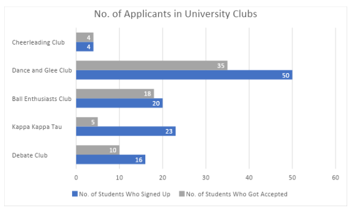
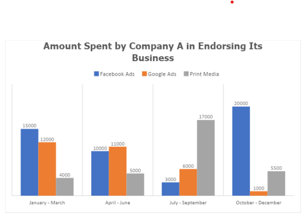

# Bar Graphs Set I

[Original Google Form](https://docs.google.com/forms/d/e/1FAIpQLScb2sbKwk9lc_DFxbWFSNpp1XZJK9Zd3-2VrYZnBvRZjIRxgA/viewform)

A. Directions. Refer to the bar graph below for Items 1-5. Choose the best answer.

### 1. Which of the following is true?

- C. The Dance and Glee Club had a higher acceptance rate than the Ball Enthusiasts Club.
- A. There are more applicants in Debate Club than in Ball Enthusiasts Club.
- D. Kappa Kappa Tau had the lowest number of new members.
- B. The Cheerleading Club had the lowest acceptance rate.
- E. The Debate Club had a 62.5% acceptance rate.

### 2. Which of the university clubs had the highest number of applicants?

- E. Debate Club
- A. Cheerleading Club
- B. Dance and Glee Club
- C. Ball Enthusiasts Club
- D. Kappa Kappa Tau

### 3. Which of the university clubs had the second highest acceptance rate?

- D. Kappa Kappa Tau
- A. Cheerleading Club
- B. Dance and Glee Club
- E. Debate Club
- C. Ball Enthusiasts Club

### 4. Which of the university clubs had the lowest acceptance rate?

- C. Ball Enthusiasts Club
- D. Kappa Kappa Tau
- A. Cheerleading Club
- E. Debate Club
- B. Dance and Glee Club

### 5. What is the acceptance rate of Dance and Glee Club?

- A. 21.7%
- B. 62.5%
- C. 70%
- D. 90%
- E. 100%

B. Directions. Refer to the bar graph below for Items 6-10. Choose the best answer.

### 6. How much did Company A spend on advertising for the third quarter?

- A. 3,000
- B. 4,000
- C. 6,000
- D. 17,000
- E. 26,000

### 7. Referring to the Company’s advertising budget in the first quarter, find the percentage it spent on print media.

- A. 8.7%
- B. 11.6%
- C. 12.9%
- D. 38.7%
- E. 48.4%

### 8. How much did the company spend on Facebook Ads for the entire year?

- A. 48,000
- B. 44,000
- C. 42,000
- D. 41,000
- E. 40,000

### 9. How much did the company spend on Google Ads for the second semester?

- A. 1,000
- B. 5,000
- C. 6,000
- D. 7,000
- E. 11,000

### 10. Company A spent least in which platform?

- A. Facebook
- B. Google
- C. Print Media
- D. Facebook and Print Media
- E. Facebook and Google
