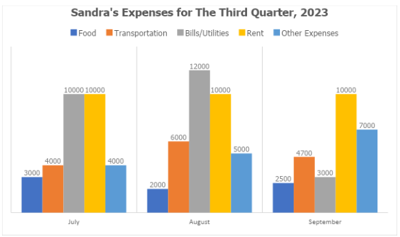
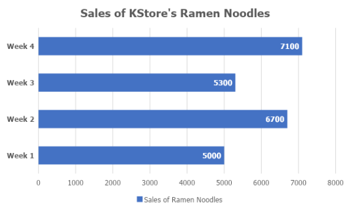

# Bar Graphs Set II

[Original Google Form](https://docs.google.com/forms/d/e/1FAIpQLScLNt_XJYSttoYddWbe4L7db87Qo_A-2hRCjaSwubyPBoEP_w/viewform)

A. Directions. Refer to the bar graph below for Items 1-5. Choose the best answer.

### 1. On average, how much did Sandra spend on Transportation?

- A. 4,000
- B. 4,700
- C. 4,900
- D. 6,000
- E. 14,700

### 2. How much did Sandra spend on food for the quarter?

- A. 2,000
- B. 2,500
- C. 3,000
- D. 3,500
- E. 7,500

### 3. Which bill is constant throughout the three months?

- A. rent
- B. utilities
- C. transportation
- D. food
- E. other expenses

### 4. On average, how much did Sandra spend on Bills/Utilities?

- A. 3,000
- B. 8,300
- C. 10,000
- D. 12,000
- E. 25,200

### 5. How much in total is Sandra's expenses for September 2023?

- A. 37,200
- B. 28,200
- C. 27,200
- D. 26,200
- E. 25,200

B. Directions. Refer to the bar graph below for Items 6-10. Choose the best answer.

### 6. Find the difference in sales between Week 3 and 4.

- A. 1,200
- B. 1,400
- C. 1,600
- D. 1,700
- E. 1,800

### 7. Which week had the second highest sales?

- A. Week 1
- B. Week 2
- C. Week 3
- D. Week 4
- E. Indeterminable

### 8. How much sales did the store earn in a month?

- A. 24,100
- B. 25,100
- C. 26,100
- D. 34,100
- E. 35,100

### 9. If the monthly gross sales of KStore remain the same for the entire year, how much will the store earn in one year?

- A. 287,200
- B. 288,200
- C. 289,200
- D. 387,200
- E. 389,200

### 10. If the government imposes a 5% tax on sales every week, how much tax will the store pay for the current month?

- A. 1,305
- B. 1,205
- C. 1,405
- D. 1,502
- E. 1,602
