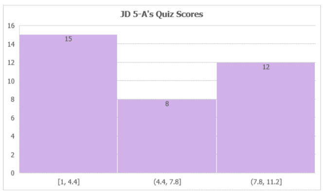
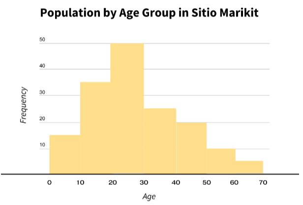

# Histogram Set I

[Original Google Form](https://docs.google.com/forms/d/e/1FAIpQLSeGYilv0EAbIE8h3rAwJZCbb16raQ2nQXeM-83peqkjS7yPPQ/viewform)

A. Directions. Refer to the histogram below for Items 1-5. Choose the best

answer.

### 1. How many students are there in the class?

- A. 15
- B. 8
- C. 12
- D. 35
- E. 20

### 2. How many items was the quiz?

- A. 5
- B. 10
- C. 12
- D. 7
- E. 8

### 3. The passing score is 75% of the total number of items, about how many students passed the quiz?

- A. 15
- B. 20
- C. 8
- D. 12
- E. none of the above

### 4. Which of the following is not true?

- A. 12 students passed the quiz.
- B. Some of the 12 students passed the quiz.
- C. 23 students failed the quiz, while the rest either passed or failed.
- D. There are more students who failed the quiz than those who passed.
- E. 15 students had a score lower than 5.

### 5. Which of the following is not true?

- A. 8 students scored between 4.4 and 7.8
- B. Only 23 students failed the quiz.
- C. Some of the 12 students aced the quiz.
- D. None of the 15 students passed the quiz.
- E. The passing score is 9 out of 12.

B. Directions. Refer to the histogram below for Items 6-10. Choose the best answer.

### 6. Which age group dominates the sitio?

- A. 10-20 years old
- B. 20-30 years old
- C. 30-40 years old
- D. 40-50 years old
- E. 50-60 years old

### 7. Which age group has the least population?

- A. 0-10 years old
- B. 30-40 years old
- C. 40-50 years old
- D. 50-60 years old
- E. 60-70 years old

### 8. The 0-10 year old population is higher than the 60-70 year old population by how many residents?

- A. 5
- B. 10
- C. 15
- D. 20
- E. 25

### 9. Which of the following is true?

- A. Their sitio has 15 infants.
- B. The sitio has unemployed residents.
- C. The sitio has 50 residents.
- D. 20 of the sitio's residents ages between 40-50 years old.
- E. The sitio has adults who are beyond 70 years old.

### 10. About how many young adults are there in the sitio?

- A. 100 or less
- B. 110 or less
- C. 95 or less
- D. 85 or less
- E. 70 or less
