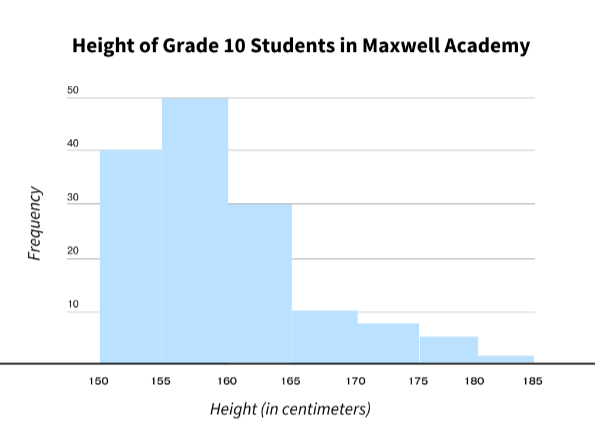
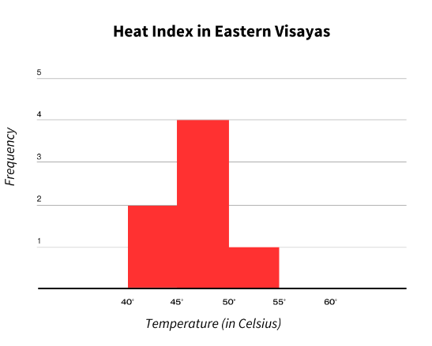

# Histogram Set II

[Original Google Form](https://docs.google.com/forms/d/e/1FAIpQLSe5GjulRrK8aO_ERr5arGUydb1Tkj4Y8_fxzZdn4-ZIBEw8Eg/viewform)

A. Directions. Refer to the histogram below for Items 1-5. Choose the best

answer.

### 1. How many students measure between 155-160 cm?

- A. 40
- B. 50
- C. 30
- D. 10
- E. 8

### 2. How many students are 165-170 cm tall?

- A. 40
- B. 50
- C. 30
- D. 10
- E. 8

### 3. Which of the following is true?

- A. Most of the students measure between 155-160 cm.
- B. 10 students are taller than those who measure between 150-155 cm.
- C. 185 students are stunted.
- D. 20 students are taller than those who measure between 160-165 cm.
- E. Students in Maxwell Academy are mostly short.

### 4. Which of the following is not true?

- A. Few students measure between 180-185 cm.
- B. The frequency of students who measure between 150-160 cm is higher than those who measure between 160-165 cm.
- C. 40 students are taller than those who measure 160-165 cm.
- D. Less than ten students are taller than the rest of the students.
- E. 5 students measure between 175-180 cm.

### 5. Which data can be inferred from the histogram?

- A. The students in the Maxwell Academy are midgets.
- B. The students who measure between 175-180 cm are most likely males.
- C. The students who measure between 150-155 cm are most likely females.
- D. 40 students are shorter than the rest of the class.
- E. There are 50 tallest students in the class.

B. Directions. Refer to the histogram below for Items 6-10. Choose the best answer.

### 6. Based on the histogram, how many days were assessed?

- A. 1
- B. 2
- C. 4
- D. 7
- E. none of the above

### 7. How many days were the heat index the highest?

- A. 1
- B. 2
- C. 4
- D. 7
- E. none of the above

### 8. How many days were the heat index the lowest?

- A. 1
- B. 2
- C. 4
- D. 7
- E. none of the above

### 9. Which of the following is true?

- A. Eastern Visayas had the hottest temperature in 4 consecutive days.
- B. Eastern Visayas had the hottest temperature in 1 day.
- C. Eastern Visayas had the lowest temperature in 1 day.
- D. Eastern Visayas experienced 4 hot days.
- E. Eastern Visayas is experiencing drought.

### 10. Which of the following is not true?

- A. The region did not experience a temperature exceeding 55 degrees.
- B. The region experienced a temperature of 45-50 degrees for four days.
- C. The histogram shows EV’s heat index in a week.
- D. The temperature in EV was relatively low for 2 days.
- E. It does not rain in Eastern Visayas.
