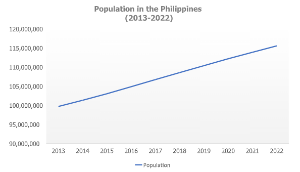
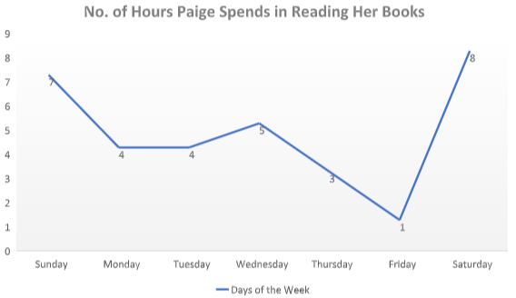

# Line Graph Set I

[Original Google Form](https://docs.google.com/forms/d/e/1FAIpQLSdAV_qH0CxZ-hgbf6JzVDb3DFeMb780A2VP6IydESRqCT60OA/viewform)

A. Directions. Refer to the line graph below for Items 1-5. Choose the best

answer.

### 1. Find the difference in population between 2016 and 2013.

- A. 50,000
- B. 500,000
- C. 5,000,000
- D. 100,000,000
- E. 105,000,000

### 2. In which trend is the line graph going?

- A. upward
- B. downward
- C. horizontal
- D. vertical
- E. indeterminable

### 3. By how many people did the population increase from 2013 to 2022?

- A. 5,000,000
- B. 15,000,000
- C. 18,000,000
- D. 20,000,000
- E. 25,000,000

### 4. Which of the following is not true?

- A. The Philippine had a population of more than 15,000,000 in 2022.
- B. The population grew by 10,000,000 from 2013 to 2019.
- C. The population from 2014 to 2016 ranges from 100M to 105M.
- D. The data will have a downward trend after 2022.
- E. The population in the Philippines grew by 5,000,000 from 2016-2019.

### 5. Which of the following can be inferred from the line graph above?

- A. The population in the Philippines remained constant since 2013.
- B. The population in the Philippines doubles every year.
- C. The data shows a horizontal trend.
- D. There is high mortality rate in the Philippines.
- E. The chances of the Philippine population growing every year is high.

B. Directions. Refer to the line graph below for Items 6-10. Choose the best answer.

### 6. On which days does Paige read the most?

- A. Sunday and Wednesday
- B. Wednesday and Saturday
- C. Sunday, Wednesday, and Saturday
- D. Monday, Tuesday, and Thursday
- E. Monday and Tuesday

### 7. On which day does Paige read the least?

- A. Monday
- B. Tuesday
- C. Wednesday
- D. Thursday
- E. Friday

### 8. How many hours does Paige spend on reading every week?

- A. 32
- B. 17
- C. 15
- D. 35
- E. 30

### 9. How many hours does Paige spend on reading every weekday?

- A. 32
- B. 17
- C. 15
- D. 35
- E. 30

### 10. Suppose the line graph remains the same for a month, how many hours will Paige spend on reading in one month?

- A. 60
- B. 68
- C. 120
- D. 128
- E. 140
