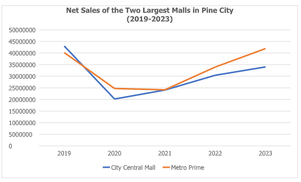
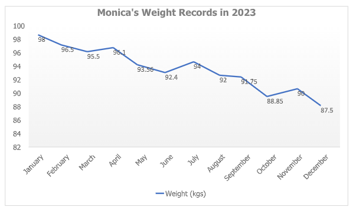

# Line Graph Set II

[Original Google Form](https://docs.google.com/forms/d/e/1FAIpQLSdk-ZrvDB_W5hs-KnsdN8U6dTA46rDlca5nCwSGkvNCbSnF4A/viewform)

A. Directions. Refer to the line graph below for Items 1-5. Choose the best answer.

### 1. Which of the following is false?

- A. Metro Prime was able to recover in 2022.
- B. City Central Mall was able to recover in 2021.
- C. City Central Mall’s net sales decreased by more than 200M in 2020.
- D. Metro Prime has been continuously thriving since 2021.
- E. City Central Mall has fewer net sales in 2023 compared to Metro Prime.

### 2. In which year did the two malls have the same net sales?

- A. 2020
- B. 2021
- C. 2022
- D. 2023
- E. none of the above

### 3. Which mall had a decrease in net sales from 2019-2021?

- A. City Central Mall
- B. Metro Prime
- C. A and B
- D. None of them
- E. Indeterminable

### 4. Which of the following can be inferred from the line graph?

- A. Both malls will continue to increase its net sales in the succeeding years.
- B. Metro Prime had the same net sales in 2020-2021.
- C. Both malls suffered a decreased in net sales in 2020.
- D. One of the two malls will decrease in net sales by 2024.
- E. City Central Mall’s net sales decreased by 200M from 2019-2020.

### 5. Metro Prime had more net sales in 2020 than City Central Mall. Find the difference of their net sales.

- A. 500,000
- B. 1,000,000
- C. 5,000,000
- D. 20,000,000
- E. 25,000,000

B. Directions. Refer to the line graph below for Items 6-10. Choose the best answer.

### 6. What is Monica’s average weight for the year?

- A. 89.01 kgs
- B. 90.01 kgs
- C. 91.01 kgs
- D. 92.01 kgs
- E. 93.01 kgs

### 7. One kilogram is equivalent to 2.2 pounds. How many pounds did she lose from June to August?

- A. 0.82 lbs
- B. 0.84 lbs
- C. 0.86 lbs
- D. 0.88 lbs
- E. 0.9 lbs

### 8. If Monica wants to weigh 15kgs less than her original weight by January 2024, how much weight should she lose?

- A. 4.5 kgs
- B. 83.5 kgs
- C. 10 kgs
- D. 5.5 kgs
- E. 8.5 kgs

### 9. How much weight did Monica lose from February to October 2023?

- A. 7.61 kgs
- B. 7.65 kgs
- C. 7.77 kgs
- D. 7.79 kgs
- E. 8.85 kgs

### 10. Monica decided to exercise every day for 5 minutes a day. She started on January 1, 2024. If she loses 0.2kgs every day, how much will Monica weigh by the last day of January 2024?

- A. 82.3 kgs
- B. 87.3 kgs
- C. 81.3 kgs
- D. 85.3 kgs
- E. 82.4 kgs
