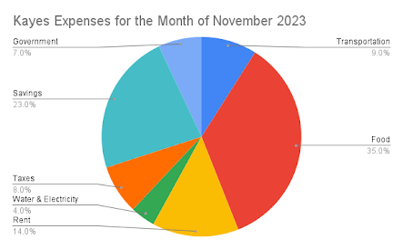

# Pie Graphs Set I

[Original Google Form](https://docs.google.com/forms/d/e/1FAIpQLSdGj0zC7bkl_XgSW_tdkqLrMVLjqsE53M1CG4su_EcWkIz44Q/viewform)

A. Directions: Refer to the pie graph below for Items 1-5. Choose the best answer.

Alexander, Angelica, Eliza, Peggy, and Aaron all ran for Philippine President in 2022. The country has 77,051,718 voters and had a 100% voter turnout. The pie graph below shows the result of the election.

### 1. Which of the following is true based on the pie graph?

- A. Alexander is not well-liked by people.
- B. Aaron is hated by the voters.
- C. Angelica won over Peggy with an 8% difference.
- D. Eliza shall become the president.
- E. Aaron will try again in the next presidential election.

### 2. Who among the following had the third highest number of votes?

- A. Alexander
- B. Angelica
- C. Eliza
- D. Peggy
- E. Aaron

### 3. Who shall be proclaimed president based on the results?

- A. Alexander
- B. Angelica
- C. Eliza
- D. Peggy
- E. Aaron

### 4. Who among the following garnered around 14M votes?

- A. Alexander
- B. Angelica
- C. Eliza
- D. Peggy
- E. Aaron

### 5. Who among them would likely receive the lowest votes?

- A. Alexander
- B. Angelica
- C. Eliza
- D. Peggy
- E. Aaron

B. Directions. Refer to the pie graph below for Items 6-10. Choose the best answer.

Kaye works as a paralegal at MCLR Law Firm. She earns a gross monthly salary of Php 43,000.00. Shown below are her expenses for the month of November 2023.

### 6. Suppose Kaye’s taxes and government contributions are already deducted from her gross salary, how much should she earn for the month?

- A. ₱36,550.00
- B. ₱25,500.00
- C. ₱37,400.00
- D. ₱36,560.00
- E. ₱25,550.00

### 7. Kaye allocated transportation allowance in the amount of ₱\_\_\_\_\_\_\_\_\_\_ for the Month of November.

- A. ₱5,000.00
- B. ₱6,500.00
- C. ₱4,500.00
- D. ₱4,120.00
- E. ₱3,870.00

### 8. How much did Kaye spend on rent?

- A. ₱5,000.00
- B. ₱4,060.00
- C. ₱6,020.00
- D. ₱4,500.00
- E. ₱5,500.00

### 9. Kaye has the most expense on which category?

- A. government contributions and savings
- B. taxes and government contributions
- C. taxes, water, and electricity
- D. rent and savings
- E. none of the above

### 10. Kaye has the least expense on which category?

- A. transportation
- B. food
- C. rent
- D. water and electricity
- E. taxes
