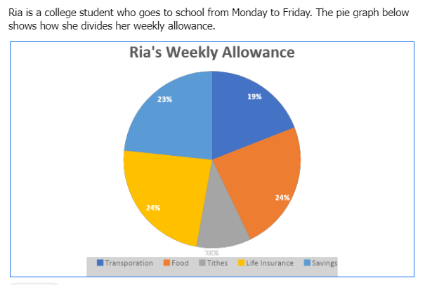

# Pie Graphs Set II

[Original Google Form](https://docs.google.com/forms/d/e/1FAIpQLSe8DYJau894YMoCoYGP_FK3yB6TqPrKnE_5jrEQzX2utsUIsw/viewform)

A. Directions. Refer to the pie graph below for Items No. 1-5. Choose the best answer.

### 1. Which of the following is true?

- A. Fifty out of 142 people enjoy rom-com movies.
- B. Ten out of 142 people enjoy horror movies.
- C. Fifteen people enjoy dramatic movies.
- D. Sci-Fi movies will be stored for storage.
- E. People enjoy documentary movies.

### 2. Which of the following may be inferred from the pie graph?

- A. More people enjoy dramatic movies than horror ones.
- B. More people enjoy sci-fi movies more than the dramatic ones.
- C. Movie-goers enjoy movies that involve romance.
- D. Movie goers enjoy comedy movies.
- E. Rom-com movies are overrated.

### 3. How many out of the 142 enjoys sci-fi movies?

- A. 1
- B. 2
- C. 3
- D. 4
- E. 6

### 4. How many out of the 142 prefer dramatic movies?

- A. 6
- B. 7
- C. 8
- D. 9
- E. 10

### 5. Which type of movie has the least viewers?

- A. Romance
- B. Sci-Fi
- C. Drama
- D. Horror
- E. Documentary

B. Directions. Refer to the pie graph below for Items 6-10. Choose the best answer.

### 6. If Ria has a daily allowance of ₱420.00 from Monday to Friday, how much does Ria spend on transportation daily?

- A. ₱59.80
- B. ₱69.80
- C. ₱79.80
- D. ₱89.80
- E. ₱99.80

### 7. Given the same premise in No. 6, how much does she spend on life insurance weekly?

- A. ₱503.00
- B. ₱504.00
- C. ₱505.00
- D. ₱506.00
- E. ₱507.00

### 8. Given the same premise on No. 6, how much is Ria going to spend on tithes every four weeks?

- A. ₱210.00
- B. ₱840.00
- C. ₱1,596.00
- D. ₱1,932.00
- E. ₱1,932.00

### 9. If Ria spends ₱40 on her daily tithes, how much is her weekly allowance?

- A. ₱400.00
- B. ₱500.00
- C. ₱1,000.00
- D. ₱2,000.00
- E. ₱3,000.00

### 10. If Ria has a weekly allowance of ₱3,000, how much will be allocated for her weekly food expenses?

- A. ₱720.00
- B. ₱840.00
- C. ₱960.00
- D. ₱1,080.00
- E. ₱1,200.00
