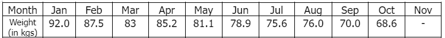
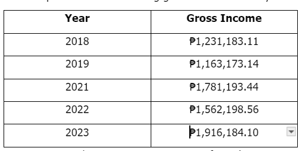

# Standard Average Problem Set I

[Original Google Form](https://docs.google.com/forms/d/e/1FAIpQLSeZvQe75CdR5BSFBQ6RgqM0ks_FMdGEFAYI7fPbg2wVweMkpg/viewform)

A. Directions. Choose the best answer.

### 1. Find the average of the following numbers: 2, 4, 6, 8, 10

- A. 4
- B. 5.5
- C. 6
- D. 6.6
- E. 8

### 2. Find the average of the following numbers: 7, 31, 3, 26, 10, 24

- A. 16
- B. 16.83
- C. 16.87
- D. 17.83
- E. 17.87

### 3. Find the average of the following numbers: 22, 96, 77, 52, 61, 23, 78

- A. 58
- B. 58.46
- C. 58.43
- D. 59
- E. 59.46

### 4. Find the average of the following numbers: 101, 143, 120, 122, 99, 89, 16, 132

- A. 102.75
- B. 102.65
- C. 101.75
- D. 101.65
- E. 100.75

### 5. Find the average of the following numbers: 1042, 1088, 1094, 1234, 1084

- A. 1105
- B. 1106
- C. 1107.4
- D. 1108.4
- E. 1119

B. Refer to the table below for the questions 6-8. Choose the best answer.

Anne is a first-year college student who weighs 92 kilograms. She wants to prepare for her eighteenth birthday on December 10, 2023 and plans to lose at least 25 kilograms before the end of November 2023. She has been tracking her weight every 30th of the month since January 2023. The following are reflected on her records, so far:

### 6. Get the average weight from April to July 2023.

- A. 81.1
- B. 80.2
- C. 80.3
- D. 79.7
- E. 81.2

### 7. What is Anne’s average weight from January to October 2023?

- A. 76.79
- B. 77.79
- C. 78.79
- D. 79.79
- E. 80.79

### 8. If Anne wants to have an average weight of 69.9kgs from August to November 2023, how much weight should she gain/lose by November 2023?

- A. Anne should gain 3.6 kgs.
- B. Anne should lose 3.1 kgs.
- C. Anne should maintain her October weight.
- D. Anne should lose 3.6 kgs.

C. Directions. Choose the best answer.

### 9. Mazi wants to compute her average gross income from the years 2021-2023. What is her average gross income for the said period?

Mazi’s Wellness Spa earned the following gross income for the years 2018-2023

- A. ₱1,753,192.03
- B. ₱1,751,392.03
- C. ₱1,735,293.03
- D. ₱1,853,392.03
- E. ₱1,753,912.03

### 10. Referring to the table in No. 9, what is Mazi’s average income from 2018 to 2023?

- A. ₱1,530,787.47
- B. ₱1,350,678.47
- C. ₱1,035,786.47
- D. ₱1,530,786.47
- E. ₱1,350,786.47
