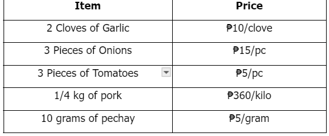
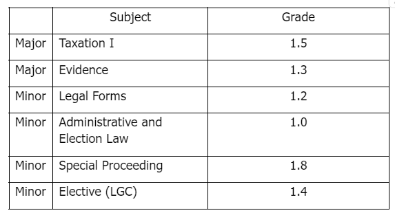

# Standard Average Problem Set II

[Original Google Form](https://docs.google.com/forms/d/e/1FAIpQLSfhaoC2SV1x01uUxQRif-QSoj9cBlKxxjUEAssOy5OZMDxcig/viewform)

II. Directions. Choose the best answer.

### 1. Find the average of the following numbers: 90, 16, 18, 98, 17.

- A. 45.8
- B. 46.8
- C. 47.8
- D. 48.8
- E. 49.8

### 2.

Cling went to the market to buy some ingredients for hersinigang. She bought the following items: 
Find the average amount Cling spent for all the items she bought in the market.

- A. ₱9.05
- B. ₱10.05
- C. ₱11.05
- D. ₱12.05
- E. ₱13.05

### 3. Using the table in No. 2, compute the average amount Cling spent on garlic and onions only.

- A. ₱10.00
- B. ₱11.00
- C. ₱12.00
- D. ₱13.00
- E. ₱14.00

### 4. Using the table in No. 2, compute the average amount Cling spent on tomatoes, pork, and pechay.

- A. ₱13.70
- B. ₱12.70
- C. ₱11.70
- D. ₱14.70
- E. ₱15.70

### 5. Paul sells different types of pens at varying prices. He sells regular ballpens for ₱15.00, gel pens for ₱25.00, and mechanical pens for ₱75.00. Find the average price of his pens.

- A. ₱38.33
- B. ₱39.33
- C. ₱40.33
- D. ₱41.33
- E. ₱42.33

### 6. Find the average of the following numbers: 198, 110, 151, 297, 102.

- A. 167.6
- B. 168.6
- C. 169.6
- D. 170.6
- E. 171.6

### 7. Chloe has 40 students. She gave them a 100-point final exam. Half of the class scored 50/100, one-fourth of the class had a score of 75/100, while the rest had perfect scores. Find the class’ average score.

- A. 65.25
- B. 66.50
- C. 67.50
- D. 68.75
- E. 69.25

### 8.

Find Maffi’s General Average for the said semester. 
Maffi had the following grades in the College of Law for the 1st Semester, School Year 2023-2024.

- A. 1.35
- B. 1.37
- C. 1.39
- D. 1.4
- E. 1.45

### 9. Using the table in No. 8, find Maffi’s average grade in her minor subjects.

- A. 1.35
- B. 1.37
- C. 1.39
- D. 1.4
- E. 1.45

### 10. Suppose Maffi’s professor in the Elective subject changes his mind and increases Maffi’s grade from 1.4 to 1.2, what will be her new General Average?

- A. 1.31
- B. 1.32
- C. 1.33
- D. 1.41
- E. 1.42
