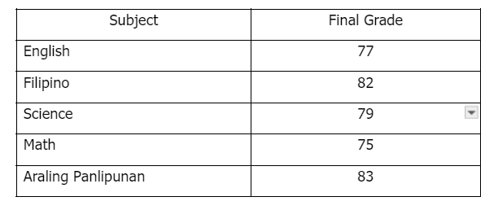
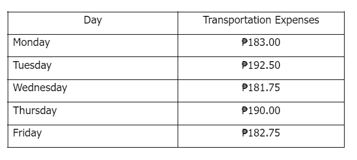
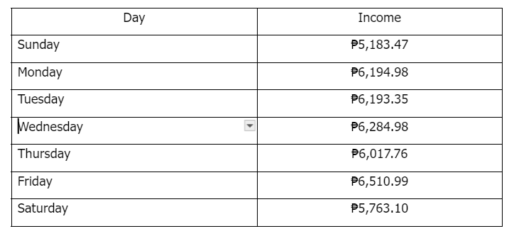
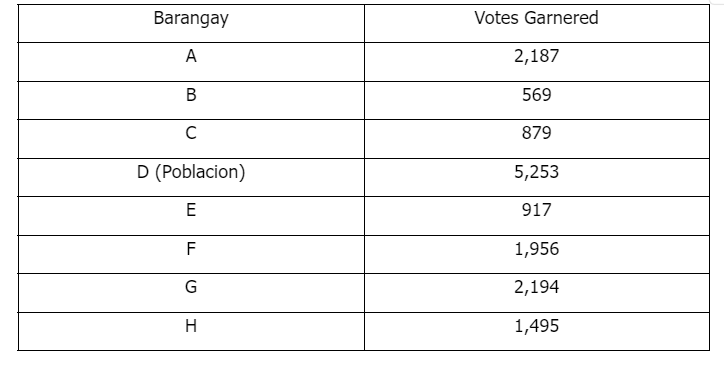

# Standard Average Problem Set III

[Original Google Form](https://docs.google.com/forms/d/e/1FAIpQLSdJ186lqqd76dpSfpfsFv_-IRz7OjugMJVvTqfuMYc6w3SCLw/viewform)

III. Directions. Choose the best answer.

### 1. Find the general average of Nicole’s final grades for the Academic Year 2023-2024.

- A. 77.2
- B. 78.2
- C. 79.2
- D. 80.1
- E. 81.3

### 2. Emman has a weekly allowance of ₱1,000.00. He noticed that he mostly spends his allowance on public transportation. One time, he decided to record his daily transportation expenses and came up with the following:

How much is Emman’s average expense on transportation?

- A. ₱185.00
- B. ₱186.00
- C. ₱187.00
- D. ₱188.00
- E. ₱189.00

### 3. Janro likes to jog around the Kanhuraw Hill in Tacloban. He jogs around the place every Monday, Wednesday, and Friday. Suppose he made a total step of 13,492 on Monday, 15,198 on Wednesday, and 12,264 on Friday, solve for his average steps.

- A. 13,651.33
- B. 13,652.33
- C. 13,562.33
- D. 13,565.33
- E. 12,265.33

### 4. Maby took a typing test and completed typing 500 words in half an hour. She took the test again and scored 460 words in 30 minutes. Combining the two typing tests, how many words per minute (wpm) can Maby type?

- A. 14 wpm
- B. 15 wpm
- C. 16 wpm
- D. 17 wpm
- E. 18 wpm

### 5. Z sells authentic gold jewelry at varying prices. Her necklaces are priced at ₱124,000.00, earrings at ₱87,000.00, rings at ₱79,000.00, and bracelets at ₱53,000.00. Find the average price of Z’s jewelry.

- A. ₱82,750.00
- B. ₱82,570.00
- C. ₱85,750.00
- D. ₱87,750.00
- E. ₱87,570.00

### 6. Kim and Lala are selling farm-to-fork salads. They sell their fresh garden salad at ₱119.00, crispy chicken salad at ₱129.00, and mango kani salad at ₱129.00. Find the average price of Kim and Lala’s salads.

- A. ₱120.67
- B. ₱122.67
- C. ₱123.67
- D. ₱124.67
- E. ₱125.67

### 7. You are a new small café owner who wants to monitor your average daily income. Your bookkeeper showed you the following summary of income during your café’s first week of operations:

How much is your average income on Sunday and Saturday only?

- A. ₱4,473.49
- B. ₱4,467.89
- C. ₱5,473.29
- D. ₱6,473.29
- E. ₱6,467.49

### 8. \[Refer to table in No. 7\] You noticed that sales are higher on weekdays. Compute your average income from Monday to Friday.

- A. ₱4,240.41
- B. ₱5,240.41
- C. ₱6,240.41
- D. ₱6,420.41
- E. ₱7,420.41

### 9. Atty. FBA is a candidate for mayor in the Half Town. He gained the following votes:

Find the average of Atty. FBA’s votes in Barangays F, G, and H.

- A. 1,662
- B. 1,772
- C. 1,882
- D. 1,992
- E. 1,994

### 10. Using the table in No. 9, solve for the average of Atty. FBA’s votes in Barangays B, C, and E.

- A. 750.33
- B. 788.33
- C. 850.33
- D. 455.33
- E. 430.33
