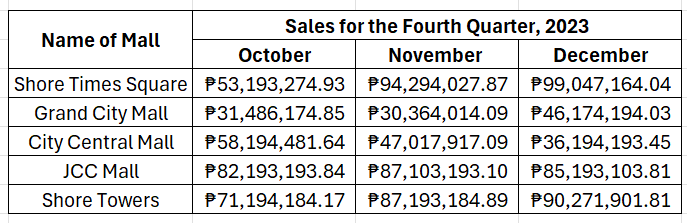
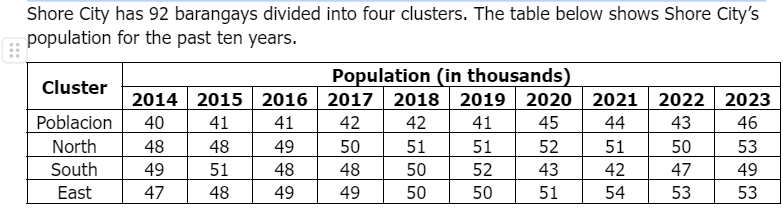

# Tables Set I

[Original Google Form](https://docs.google.com/forms/d/e/1FAIpQLScrPYEjW2IJImV_CQPr-D365LyFTqiHOzCObzvs_DSGSoSGxQ/viewform)

A. Directions. Refer to the table below for Items No. 1-5. Choose the best answer.

There are five competing malls in Shore City. They have the following net sales for the fourth (4th) quarter of 2023:

### 1. Which of the following is true?

- A. Shore Times Square has the highest net sales for the quarter.
- B. City Central mall has the lowest net sales for the quarter.
- C. Grand City Mall has the lowest net sales for the quarter.
- D. JCC Mall has an upward sales trend during the quarter.
- E. Shore Towers has the highest sales for the quarter.

### 2. Which mall has the second highest sales for the quarter?

- A. Shore Times Square
- B. Grand City Mall
- C. City Central Mall
- D. JCC Mall
- E. Shores Tower

### 3. Which mall has a declining net sales from October to December?

- A. Shore Times Square
- B. Grand City Mall
- C. City Central Mall
- D. JCC Mall
- E. Shores Tower

### 4. Which mall has the lowest sales for the quarter?

- A. Shore Times Square
- B. Grand City Mall
- C. City Central Mall
- D. JCC Mall
- E. Shores Tower

### 5. Which mall/s has/have an upward sales trend for the quarter?

- A. Shore Times Square
- B. Shore Towers
- C. JCC Mall
- D. Shore Towers and JCC Mall
- E. Shores Times Square and Shore Towers

B. Directions. Refer to the table below for Items 6-10. Choose the best answer.

### 6. Which of the following is true?

- A. North has been increasing in population from 2014 to 2020.
- B. East’s population increased by 5,000 from 2014 to 2023.
- C. Poblacion’s population increased by 5,000 from 2019-2020.
- D. South decreased in population from 2014 to 2023.
- E. All clusters increased in population from 2017-2018.

### 7. Which cluster has the second highest increase in population from 2022-2023?

- A. Poblacion
- B. North
- C. South
- D. East
- E. None

### 8. Which cluster had an increase in population in 2021?

- A. Poblacion
- B. North
- C. South
- D. East
- E. None

### 9. Which cluster has the highest increase in population from 2019-2020?

- A. Poblacion
- B. North
- C. South
- D. East
- E. None

### 10. Which cluster decreased in population from 2014 to 2016?

- A. Poblacion
- B. North
- C. South
- D. East
- E. None
