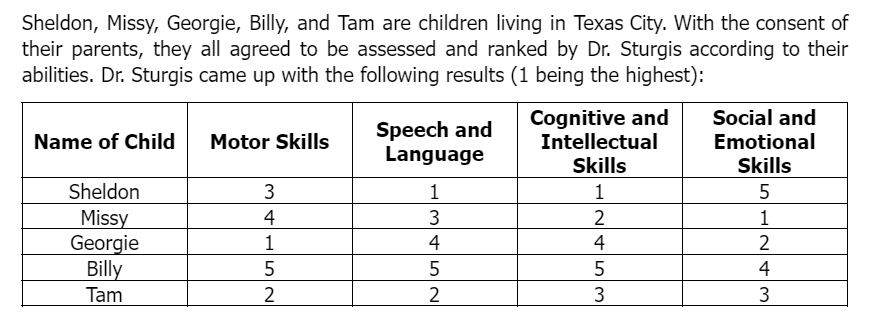
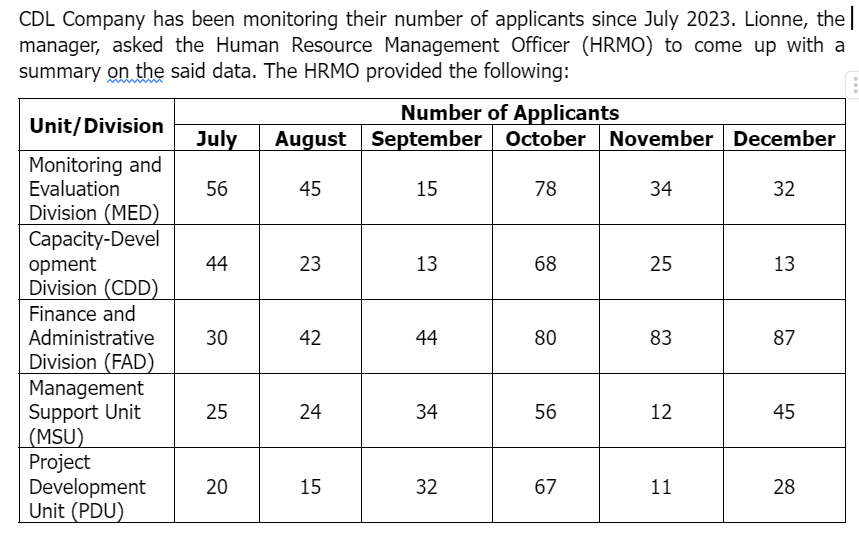

# Tables Set II

[Original Google Form](https://docs.google.com/forms/d/e/1FAIpQLSfXjVGjFfwLdgsT5QwTq0z7OREKjJDDqkNMBPfKfqXHNByICQ/viewform)

A. Directions. Refer to the table below for Items No. 1-5. Choose the best answer.

### 1. Which of the following is not true?

- A. Sheldon and Missy have a huge difference in their social and emotional skills.
- B. Georgie has more ability to perform physical tasks compared to the other children.
- C. Missy has better problem-solving skills than Tam.
- D. Tam can express his thoughts better than Georgie
- E. Billy can perform better in physical tasks than Georgie.

### 2. Who among the children is most likely to have many friends?

- A. Sheldon
- B. Missy
- C. Georgie
- D. Billy
- E. Tam

### 3. Who among the children will rank last in Dr. Sturgis’ overall assessment?

- A. Sheldon
- B. Missy
- C. Georgie
- D. Billy
- E. Tam

### 4. Who among the children will rank first if assessed on cognitive and social skills only?

- A. Sheldon
- B. Missy
- C. Georgie
- D. Billy
- E. Tam

### 5. Who among the children will rank second if assessed on speech and motor skills only?

- A. Sheldon
- B. Missy
- C. Georgie
- D. Billy
- E. Tam

B. Directions. Refer to the table below for Items 6-10. Choose the best answer.

### 6. Which unit/division has a total of 260 applicants from July to December?

- A. MED
- B. CDD
- C. FAD
- D. MSU
- E. PDU

### 7. Which month has the greatest number of applicants?

- A. July
- B. August
- C. September
- D. October
- E. November

### 8. Which unit/division has the least number of applicants from July to December?

- A. MED
- B. CDD
- C. FAD
- D. MSU
- E. PDU

### 9. Which unit/division has the greatest number of applicants from July to December?

- A. MED
- B. CDD
- C. FAD
- D. MSU
- E. PDU

### 10. Which month yielded a total number of 149 applicants?

- A. July
- B. August
- C. September
- D. November
- E. December
